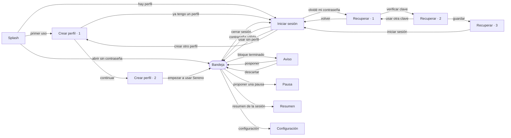

# Sereno

Sereno es un asistente de escritorio para Windows que avisa cuándo tomar una micropausa sin interrumpir la tarea en curso: temporiza bloques de foco, avisa al terminar por el canal que elijas, propone una micropausa concreta y lleva un historial de la sesión sin calificar nada.

El código está organizado en cuatro proyectos (ver [Estructura](#estructura)): `Sereno.Core` concentra la lógica pura sin dependencias de Windows, `Sereno.Platform` los adaptadores de Windows, `Sereno.Desktop` la aplicación WPF, y `Sereno.Tests` los tests de las dos primeras capas.

Proyecto integrador de **Programación Genérica y Eventos** · Universidad Blas Pascal · Ingeniería en Informática.

## Por qué hay perfiles

La definición original de Sereno no contemplaba cuentas de usuario. Durante el desarrollo apareció una limitación: la aplicación no podía distinguir a las personas que comparten una misma computadora. Por eso se incorporó un **perfil local y opcional**:

- No usa email, servidor ni conexión a internet.
- Cada persona tiene su propia carpeta de datos.
- La contraseña se recupera con una **clave de recuperación** que se genera al crear el perfil y se guarda como archivo `.txt` en la carpeta del usuario.
- Quien no quiera contraseña puede usar Sereno sin perfil o marcar "Abrir sin pedir contraseña".

## Pantallas

| Pantalla | Qué hace |
|---|---|
| Splash | Carga los perfiles en segundo plano (menos de 2 s) y decide qué mostrar. |
| Iniciar sesión | Abre el perfil con su contraseña. Permite cambiar de perfil, recuperar el acceso, crear otro perfil o usar Sereno sin perfil. |
| Crear perfil | Paso 1: nombre y contraseña, con medidor de fuerza. Paso 2: clave de recuperación, con botones para copiarla o guardarla como `.txt`. |
| Recuperar acceso | Paso 1: verificar la clave. Paso 2: nueva contraseña. Paso 3: confirmación. |
| Aviso breve de inicio | Confirma que la sesión arrancó. Aparece 5 segundos en la esquina y se cierra sola. |
| Bandeja del sistema | Con la sesión iniciada, Sereno vive acá. El ícono muestra un punto verde con un bloque en curso y gris sin él; el tooltip tiene los minutos restantes. Clic derecho: proponer una pausa, resumen de la sesión, configuración, cerrar sesión y salir. |
| Aviso de fin de bloque | Aparece al terminar un bloque, por el canal elegido. No toma el foco ni aparece en la barra de tareas ni en Alt+Tab. Se puede posponer 5 minutos o descartar, con clic o con Ctrl+Alt+P / Ctrl+Alt+D, y se cierra sola pasado el tiempo configurado. |
| Pausa | Propone micropausas que entran en la duración de pausa configurada, con ícono, nombre, duración y descripción. Las que tienen varios pasos se recorren con avance manual o automático. |
| Resumen de la sesión | Bloques completados, pausas tomadas y avisos pospuestos de la sesión actual, con el registro más reciente primero y la opción de deshacer el último. Ningún texto califica el desempeño. |
| Configuración | Duración de bloques y pausas, canal del aviso, modo bajo estímulo, tiempo del aviso visual, lectura y visualización (fuente, alto contraste, espaciado, escala), y datos: dónde están, exportar y borrar. |

## Prototipo y maquetas

- [`docs/prototipo-acceso.html`](docs/prototipo-acceso.html): el prototipo del módulo de acceso. La contraseña de prueba es `sereno123`.
- [`docs/boceto-aviso.html`](docs/boceto-aviso.html): boceto del aviso no bloqueante y de la configuración.
- [`docs/maquetas-interfaz.html`](docs/maquetas-interfaz.html): maquetas de configuración completa, pausa, resumen de sesión y datos/privacidad.

Se abren con cualquier navegador.

## Requisitos

- Windows 10 u 11
- [.NET 8 SDK](https://dotnet.microsoft.com/download/dotnet/8.0)
- Visual Studio 2022 (17.8 o posterior) con la carga de trabajo **Desarrollo de escritorio de .NET**, o solo la CLI de .NET

## Compilar y ejecutar

**Con Visual Studio:** abrir `Sereno.sln`, establecer `Sereno.Desktop` como proyecto de inicio y presionar F5.

**Con la terminal:**

```bash
git clone https://github.com/RRDev48/UBP_PGE.Sereno.git
cd UBP_PGE.Sereno
dotnet build
dotnet run --project src/Sereno.Desktop
```

**Generar un ejecutable:**

```bash
dotnet publish src/Sereno.Desktop -c Release -r win-x64 --self-contained false -o publish
```

Solo se puede ejecutar una instancia a la vez. Si Sereno ya está abierto, un segundo inicio muestra un aviso y se cierra.

## Correr los tests

```bash
dotnet test
```

`Sereno.Tests` cubre `Sereno.Core` (hashing, clave de recuperación, reglas de contraseña, duraciones,
`BlockTimer` con un reloj falso, `EventBus`, el catálogo de micropausas, el historial con su pila
propia) y `Sereno.Platform` (`AlmacenPerfiles` con carpetas temporales por test, la regla de qué
estados de presentación no conviene interrumpir), más un test de arquitectura que falla si
`Sereno.Core` llega a referenciar `PresentationFramework`, `WindowsBase` o `System.Windows.Forms`.

## Estructura

El proyecto está dividido en cuatro capas. La regla central de la arquitectura es que
**`Sereno.Core` no referencia nada de WPF ni de Windows**: es lógica pura, testeable sin
depender de la plataforma. `Sereno.Platform` traduce esa lógica a APIs de Windows (archivos,
bandeja del sistema, voz, detección de pantalla completa). `Sereno.Desktop` es la aplicación WPF
que junta todo.

```
Sereno.sln
├── src/Sereno.Core/         net8.0 · sin WPF ni Windows
│   ├── Events/              EventBus, IEvent, SubscriptionToken, EventQueue
│   ├── Timing/              IClock, BlockTimer, BlockState, BloqueTerminado, Duraciones, PlanBloques
│   ├── History/             SessionHistory, Pila<T>
│   ├── Breaks/              BreakCatalog, BreakSuggestion, BreakStep
│   ├── Acceso/              Hasher, ClaveRecuperacion, ReglasContrasena
│   └── Modelos/             Perfil, Configuracion, PerfilEventArgs, PreferenciasVisuales, PreferenciasAviso
│
├── src/Sereno.Platform/     net8.0-windows · adaptadores de Windows
│   ├── Storage/             AlmacenPerfiles, Rutas
│   ├── Tray/                BandejaService (ícono de la bandeja, con estado y tooltip)
│   ├── Timing/              RelojMonotono (IClock sobre Stopwatch)
│   ├── Speech/              LectorVoz (System.Speech)
│   └── Notifications/       EstadoPresentacion (pantalla completa / presentación)
│
├── src/Sereno.Desktop/      net8.0-windows · WinExe, WPF · la aplicación
│   ├── App.xaml(.cs)        Punto de entrada y coordinador de la navegación
│   ├── Vistas/
│   │   ├── SplashWindow        Pantalla de carga
│   │   ├── LoginWindow         Iniciar sesión
│   │   ├── RegistroWindow      Crear perfil (2 pasos)
│   │   ├── RecuperarWindow     Recuperar acceso (3 pasos)
│   │   ├── AvisoWindow         Aviso de fin de bloque (posponer / descartar)
│   │   ├── AvisoBreveWindow    Confirmación breve sin acciones (inicio de sesión)
│   │   ├── PausaWindow         Catálogo de micropausas y rutinas en pasos
│   │   ├── ResumenWindow       Resumen de la sesión y deshacer
│   │   └── ConfiguracionWindow Duraciones, canal del aviso, lectura y datos
│   ├── Controles/
│   │   ├── CampoContrasena  PasswordBox + botón mostrar + ayuda + error
│   │   ├── CampoTexto       TextBox con el mismo formato
│   │   ├── IndicadorPasos   Pasos con número, texto y estado
│   │   ├── Marca            Luna + "Sereno"
│   │   └── AvisoPrivacidad  Candado + texto al pie
│   ├── Servicios/
│   │   ├── TemaService             Tema (claro o alto contraste) y fuente de lectura
│   │   ├── Accesibilidad           Anuncios para lectores de pantalla (con y sin foco)
│   │   ├── MotorDeBloques          Impulsa el BlockTimer y avisa cambios de estado
│   │   ├── AvisoFinDeBloque        Decide el canal del aviso y lo muestra
│   │   ├── VentanaFlotante         Ventana que no toma el foco ni aparece en Alt+Tab
│   │   ├── AtajosGlobales          Atajos de teclado activos solo mientras el aviso está abierto
│   │   ├── EspaciadoVisual         Factor de interlineado compartido por los textos
│   │   └── InterlineadoConvertidor Calcula el alto de línea según ese factor
│   ├── Temas/               Claro.xaml, AltoContraste.xaml, Estilos.xaml
│   └── Recursos/            sereno.ico, Fuentes/ (Atkinson Hyperlegible, licencia OFL)
│
└── tests/Sereno.Tests/      net8.0-windows · xUnit
```

Referencias entre proyectos:

| Proyecto | Referencia a |
|---|---|
| `Sereno.Core` | ninguna |
| `Sereno.Platform` | `Sereno.Core` |
| `Sereno.Desktop` | `Sereno.Core`, `Sereno.Platform` |
| `Sereno.Tests` | `Sereno.Core`, `Sereno.Platform` |

`Sereno.Tests` apunta a `net8.0-windows` (en vez de `net8.0`) porque referencia a
`Sereno.Platform`, que necesita Windows Forms para `NotifyIcon`; un proyecto `net8.0` no puede
referenciar a uno `net8.0-windows`.

**Un caso de esta regla:** `BandejaService` (bandeja del sistema) usa
`System.Windows.Forms.NotifyIcon`, pero el ícono que muestra viene de un recurso empaquetado de
WPF. Como `Sereno.Platform` no puede depender de WPF, `BandejaService` no busca el ícono por su
cuenta: su constructor recibe un `Stream` (o `null`, para usar el ícono del sistema). Quien arma
ese `Stream` a partir del recurso empaquetado es `Sereno.Desktop.App`, que sí conoce WPF. El
mismo patrón se repite con `RelojMonotono` (Platform) implementando `IClock` (Core), y con
`LectorVoz` / `EstadoPresentacion`, que `AvisoFinDeBloque` (Desktop) consume sin que Core sepa que
existen.

## Flujo entre pantallas



## El temporizador y el aviso

`BlockTimer` (Core) mide un bloque contra un `IClock`: no tiene reloj propio, así que un test
puede avanzar un bloque de 25 minutos en milisegundos con un reloj falso. `MotorDeBloques`
(Desktop) lo impulsa cada medio segundo con un `DispatcherTimer`, y también al reanudar de una
suspensión (`SystemEvents.PowerModeChanged`), para no acumular avisos atrasados. Al cumplirse la
duración, `BlockTimer` publica un único evento `BloqueTerminado` en el `EventBus` (Core.Events).

`AvisoFinDeBloque` (Desktop) escucha ese evento y decide qué hacer según el canal configurado
(`Sereno.Core.Modelos.CanalAviso`):

| Canal | Qué pasa |
|---|---|
| Solo visual (por defecto) | Se muestra `AvisoWindow`, más una notificación nativa de refuerzo. |
| Solo hablado | Se lee con `LectorVoz`, sin ventana. |
| Visual y hablado | Las dos cosas. |
| Solo notificación del sistema | Solo el globo de la bandeja. |

Si no hay voz en español instalada, los canales hablados caen a solo visual en vez de fallar
(`CanalesAviso.Efectivo`). El canal visual, además, espera si `EstadoPresentacion.PantallaOcupada()`
detecta una app a pantalla completa o una presentación (reintenta cada 2 segundos y desiste a los
5 minutos), para no interrumpir una videollamada.

`AvisoWindow` no toma el foco (`VentanaFlotante`, con `WS_EX_NOACTIVATE` y `WS_EX_TOOLWINDOW`), así
que tampoco recibe Tab ni Enter: posponer y descartar se operan con clic o con los atajos globales
`Ctrl+Alt+P` / `Ctrl+Alt+D` (`AtajosGlobales`, registrados solo mientras el aviso está visible). Para
que los lectores de pantalla lo anuncien igual, `Accesibilidad.Anunciar` dispara
`AutomationPeer.RaiseNotificationEvent`, que no depende del foco (a diferencia del evento de región
activa tradicional).

### Lucero

Lucero es la chispa (`Controles/Mascota.cs`) que acompaña los avisos flotantes: una sola forma de
cuatro puntas con un halo, sin cara ni nombre de personaje infantil, en la línea de los indicadores
de otros asistentes. Respira suavemente mientras un aviso está visible y reacciona apenas antes de
cerrarse (se atenúa al posponer, se achica rápido al descartar, un pulso breve al empezar la
pausa) — nunca con caritas felices o tristes, para no calificar la elección de la persona. El halo
también cambia de tono según la hora real: más pálido de día, más cálido de noche. Aparece en:

- `RecordatorioWindow`, cada 5 minutos mientras un bloque está en curso (`RecordatorioMascota`
  escucha `MotorDeBloques.EstadoCambio` y avisa en los múltiplos de 5, nunca apenas arranca el
  bloque).
- `AvisoWindow`, el aviso de fin de bloque.
- `AvisoBreveWindow`, la confirmación de que la sesión quedó activa en la bandeja.

Todas sus animaciones respetan el mismo `animar` que el resto de la app: quieta con bajo estímulo,
alto contraste o animaciones de Windows desactivadas.

## Pausas

`BreakCatalog` (Core.Breaks) tiene seis micropausas fijas, con nombre, ícono, duración y
descripción, incluida la regla de descanso visual 20-20-20; `Para(minutos)` filtra las que entran
en la pausa configurada. Las que tienen varios pasos (como "Estirar la espalda") se muestran en
`PausaWindow` como una rutina ordenada, con el paso actual destacado y avance manual o automático;
se puede abandonar en cualquier momento sin mensajes.

## Historial de la sesión

`SessionHistory` (Core.History) registra bloques completados, pausas tomadas y acciones sobre el
aviso en una pila propia (`Pila<T>`, sin usar `Stack<T>` del framework). Deshacer quita el registro
más reciente, en orden inverso al de creación. `ResumenWindow` muestra los contadores y el
registro; ningún texto califica el desempeño ni compara con otras sesiones. El historial vive solo
en memoria: no se guarda entre sesiones.

## Programación por eventos

Dos mecanismos conviven a propósito. Las ventanas de WPF no se conocen entre sí: cada una dispara
eventos de .NET y `App` decide qué mostrar a continuación. El dominio (el fin de un bloque) usa en
cambio el `EventBus` propio de `Sereno.Core.Events`, para que esa lógica no dependa de WPF y se
pueda testear sin abrir ninguna ventana.

| Evento | Lo dispara | Qué hace `App` |
|---|---|---|
| `CargaCompleta` | `SplashWindow` | Decide entre crear perfil, iniciar sesión o ir a la bandeja. |
| `SesionIniciada` | `LoginWindow` | Recuerda el perfil, pasa a la bandeja e inicia un bloque. |
| `RecuperacionSolicitada` | `LoginWindow` | Abre la recuperación para ese perfil. |
| `CreacionSolicitada` | `LoginWindow` | Abre el registro. |
| `UsoSinPerfilSolicitado` | `LoginWindow`, `RegistroWindow` | Entra con el perfil compartido. |
| `RegistroCompletado` | `RegistroWindow` | Pasa a la bandeja con el perfil nuevo. |
| `VolverSolicitado` | `RegistroWindow`, `RecuperarWindow` | Vuelve al inicio de sesión. |
| `CierreDeSesionSolicitado` | `BandejaService` | Detiene el bloque, oculta la bandeja y muestra el inicio de sesión. |
| `SalidaSolicitada` | `BandejaService` | Cierra la aplicación. |
| `ConfiguracionSolicitada` / `PausaSolicitada` / `ResumenSolicitado` | `BandejaService` | Abren esa pantalla. |
| `BloqueTerminado` (EventBus) | `BlockTimer` | `AvisoFinDeBloque` registra el bloque en el historial y avisa por el canal elegido. |

Los controles también exponen eventos propios (`ContrasenaCambiada`, `TextoCambiado`), que las ventanas usan para limpiar errores y actualizar el medidor de fuerza mientras la persona escribe. Las operaciones lentas, como la verificación de contraseñas, se ejecutan con `async`/`await` para que la interfaz no se congele.

## Dónde se guardan los datos

Todo queda dentro de la carpeta del usuario de Windows:

```
%APPDATA%\Sereno\
├── config.json                  Duraciones, canal del aviso, preferencias visuales, último perfil
└── Perfiles\
    ├── lucia-3f9a1c\
    │   ├── perfil.json          Datos del perfil (sin contraseñas en texto plano)
    │   └── clave-recuperacion.txt
    └── _compartido\
        └── perfil.json          Perfil de "Usar Sereno sin perfil"
```

Ejemplo de `perfil.json`:

```json
{
  "Id": "3f9a1c0b7e2d4c55a1f0e9b8c7d6a5f4",
  "Nombre": "Lucía",
  "EsCompartido": false,
  "HashContrasena": "q8m1…",
  "SalContrasena": "Zt4r…",
  "HashClave": "c0Pk…",
  "SalClave": "Yh2w…",
  "Iteraciones": 210000,
  "AbrirSinContrasena": false,
  "CreadoEn": "2026-09-15T10:32:00"
}
```

El archivo `clave-recuperacion.txt` se crea al presionar **Guardar como archivo** en el paso 2 del registro. Contiene el nombre del perfil, la fecha y la clave con formato `XXXX-XXXX-XXXX-XXXX`.

Desde **Configuración → Datos y privacidad** se puede exportar un `.txt` legible (perfiles y
configuración, sin hashes ni claves) o borrar toda la carpeta de Sereno; borrar pide confirmación y
cierra la aplicación al terminar.

Para empezar de cero a mano, cerrá Sereno y borrá la carpeta `%APPDATA%\Sereno`.

## Seguridad

- La contraseña y la clave de recuperación se guardan como **hash PBKDF2-SHA256** con 210.000 iteraciones y una sal aleatoria de 16 bytes por secreto.
- La verificación usa comparación en tiempo constante (`CryptographicOperations.FixedTimeEquals`).
- La clave se genera con `RandomNumberGenerator` y usa un alfabeto sin `0`, `O`, `1` ni `I` para evitar confusiones al copiarla.
- Los archivos se escriben primero en un temporal y después se reemplazan, para no dejar datos a medio guardar.
- Sereno no hace ninguna solicitud de red: todo el acceso y la síntesis de voz son locales.

**Limitación conocida:** el archivo `clave-recuperacion.txt` queda en la misma carpeta que el perfil. Cualquier persona con acceso a esa carpeta de Windows puede leer la clave y cambiar la contraseña. El perfil separa historiales entre personas de confianza que comparten un equipo; no reemplaza a la cuenta de Windows como medida de seguridad.

## Accesibilidad

| Criterio | Cómo se aplica |
|---|---|
| Contraste | Texto de al menos 4.5:1 en el tema claro; tema de alto contraste con al menos 7:1. |
| Tamaño de los controles | Botones, casillas y áreas clicables miden al menos 44 × 44 px. |
| Color | Los errores combinan ícono, texto y borde. El medidor de fuerza dice "débil", "aceptable" o "fuerte". |
| Teclado | Las pantallas se operan con Tab, Enter y la barra espaciadora, con foco visible. El aviso, que no toma foco a propósito, se opera con Ctrl+Alt+P / Ctrl+Alt+D. |
| Lectores de pantalla | Nombres accesibles en los campos. Los cambios de estado se anuncian con regiones *live* y, además, con `RaiseNotificationEvent`, que no depende de que el elemento tenga el foco. |
| Movimiento | Si Windows tiene las animaciones desactivadas o el contraste alto activo, el splash no se anima. El modo bajo estímulo se puede forzar manualmente. |
| Tema | Sigue la configuración clara u oscura de Windows, o se puede fijar en alto contraste. |
| Lectura | Fuente Atkinson Hyperlegible opcional, espaciado amplio entre líneas y escala de texto de 100, 125 o 150 %, aplicados como transformación de diseño sobre cada ventana. |
| Voz | Lectura del aviso en voz alta, apagada por defecto, con la voz en español instalada en Windows. Se corta al descartar el aviso. |

**Pendiente de verificar a mano:** la lectura real con NVDA o Narrador, el foco visible y el orden de tabulación en todas las pantallas, y una revisión de que los textos usan lenguaje claro y sin jerga.

## Estado

**Incluido en esta versión**

- Las cuatro pantallas de acceso y la bandeja del sistema, con varios perfiles por computadora y perfil compartido.
- Bloques de foco configurables (5 a 90 min) y pausas (1 a 30 min), con un temporizador sobre reloj monótono que no reinicia un bloque en curso al cambiar la configuración.
- Aviso de fin de bloque no bloqueante, con posponer, descartar, cuatro canales (visual, hablado, ambos, sistema) y tiempo visible configurable.
- Catálogo de micropausas con rutinas en pasos, y resumen de sesión con deshacer.
- Preferencias de lectura (fuente, contraste, espaciado, escala) y exportar/borrar los datos locales.

**Pendiente**

- Voces modernas en español (Pablo, Laura) vía WinRT; hoy se usa la voz clásica del sistema.
- Medir los requisitos no funcionales (memoria, CPU, tiempo de arranque) contra los objetivos definidos.
- Prueba con personas reales, según el protocolo ya definido.
- Revisión de foco/tabulación y de lenguaje claro pantalla por pantalla.
- Eliminar o renombrar perfiles desde la interfaz.

Si alguien cierra la ventana en el paso 2 del registro, el perfil ya quedó creado y puede entrar con su contraseña, pero la clave no se vuelve a mostrar. Si no la copió ni la guardó, no va a poder recuperar el acceso si olvida la contraseña.

## Autor

Rodríguez, Rodrigo Emmanuel · Profesora: Julia Bulacio
